<div align="center">

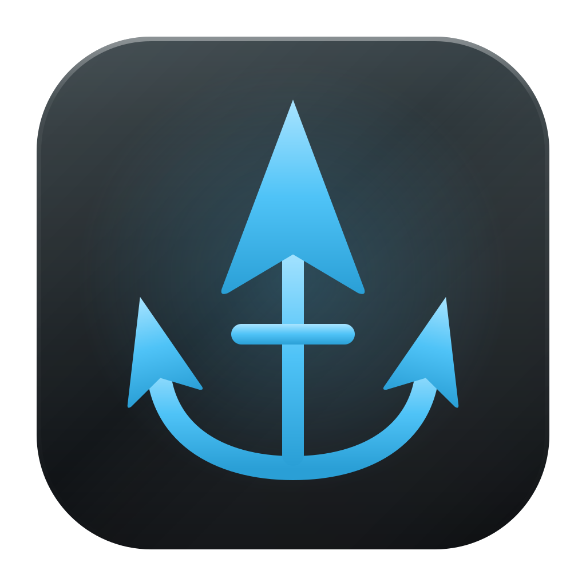

# Kvistcode

**Every coding agent, one calm place.**

One desktop app to run Claude Code, OpenAI Codex, xAI Grok, local models and any ACP agent side by side,<br />
across all your accounts, with every project isolated in its own git worktree.

[](https://github.com/pl0xuee/kvistcode/actions/workflows/ci.yml)
[](https://github.com/pl0xuee/kvistcode/releases/latest)
[](LICENSE)

[](https://kvistcode.com/support/)

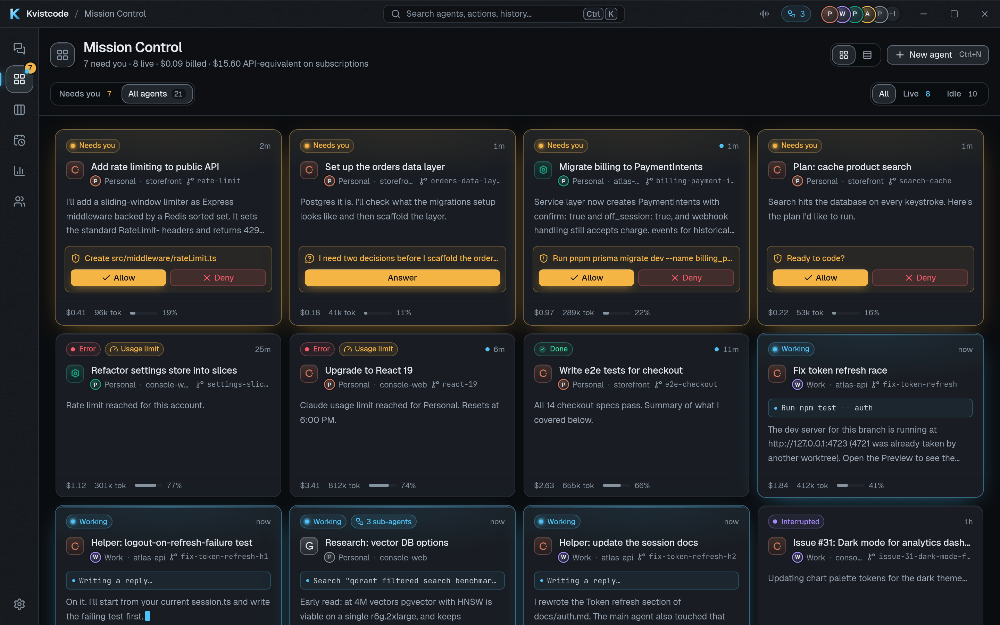

</div>

> The screenshots in this README come from Kvistcode's built-in demo data (fictional projects and accounts), not from a real workspace.

## Why Kvistcode

Coding agents are most useful when you can run several at once, but each vendor ships its own terminal UI, its own login and its own idea of a session. Kvistcode puts them in one place. It drives each vendor's **official agent runtime** (it never reimplements an agent or scrapes a login), so your subscriptions are used exactly as the vendor intends. Each agent gets its own branch and working copy, so parallel work doesn't collide, and you get one live view of who is working, who is stuck and who needs you.

## Features

### Agents from every provider

- **Claude Code, OpenAI Codex, xAI Grok Build**, plus any agent that speaks the [Agent Client Protocol](https://agentclientprotocol.com) (Gemini CLI, Goose, OpenCode or your own), added as a first-class provider with a connection test.
- **Local models.** Run agents on Ollama, LM Studio or any OpenAI-compatible server (llama.cpp, vLLM, a GPU box on your network). Kvistcode detects Ollama and LM Studio, lists their models, and lets you pick one per agent. Local agents are free and need no sign-in; nothing leaves your computer unless you point at another machine, which Kvistcode warns about. See the [quickstart](#run-models-locally).
- **Multiple accounts per provider.** Every account has its own isolated login, so you can run two Claude Max accounts and three ChatGPT accounts at once. API keys are kept in your OS keychain.
- **Compare mode.** Send one prompt to several providers, read the answers side by side and keep the one you like. **Handoff** lets one agent review another's work ("have Codex review Claude's work").
- **Many agents per project.** Start up to 8 on the same task. They open together as full conversations in a grid that fits the window, each in its own worktree so they can't overwrite each other, and **Add agents** in an agent's header starts more in the same project. The sidebar is organised by project.
- Agents survive closing the window (Kvistcode lives in the tray), crashes and reboots, and can be resumed.
- Messages typed while an agent is busy queue up and run in order; edit, drop or send one right now. Paste screenshots or attach images, and `@`-mention files with fuzzy search. Slash-command autocomplete shows each agent's own commands.

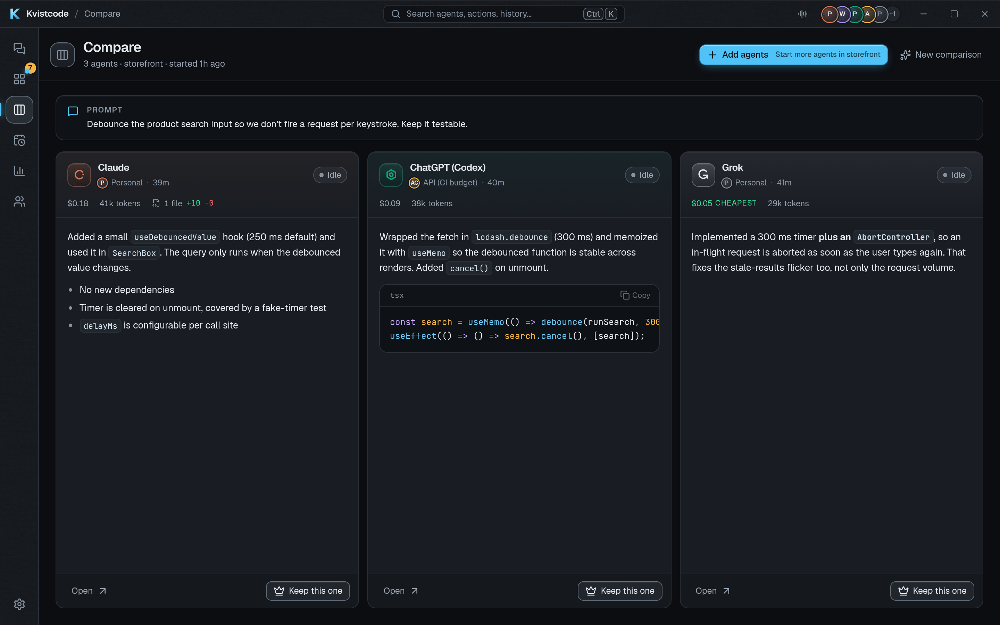

### A calmer conversation

- **Quiet timeline.** Runs of tool calls and thoughts fold into one line ("Read 4 files, edited 2 files, ran 3 commands"); answers, approvals, plans and errors stay in view.
- **Clear signals.** A thinking indicator while the agent works, then a "Done" line with the turn's time, a green status pill, a window title that shows what the selected agent is doing, and an optional chime for long tasks.
- **Syntax highlighting** in code blocks, diffs and commands, matching each theme (Gunmetal, Carbon and Titanium).
- **Images inline.** Screenshots that agents take or view appear as pictures, not file paths.

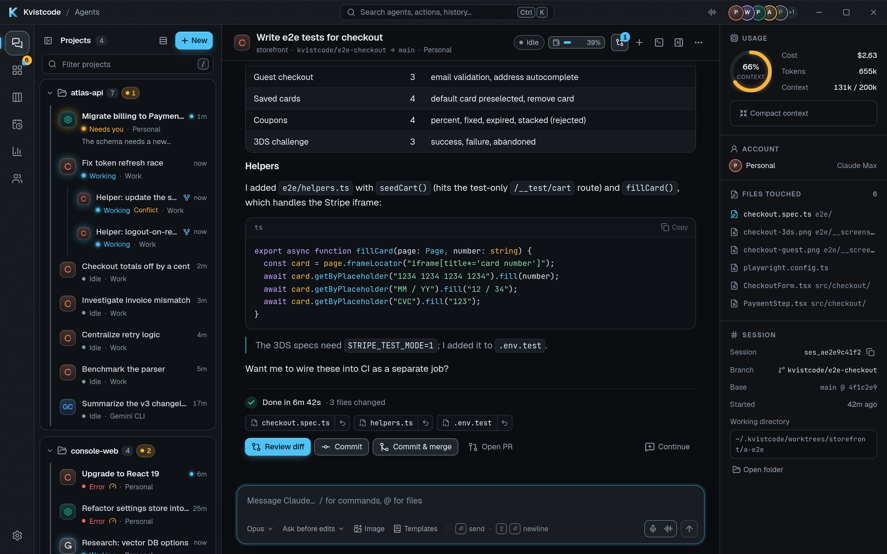

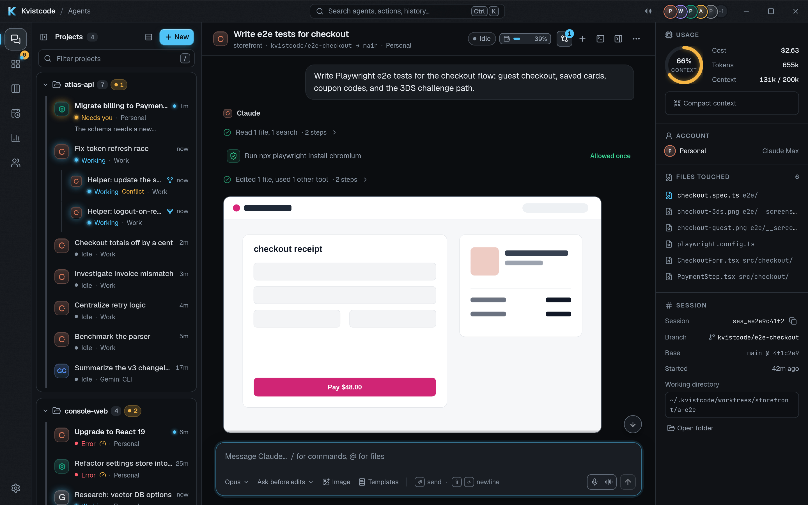

### Workspace: terminals, scripts, preview

Each agent has a workspace panel (`` Ctrl/Cmd+` ``) in its own folder:

- **Terminals** with a "Send to agent" button that pastes output into the message box.
- **Scripts** detected from your project (npm, pnpm, yarn, bun, cargo, make, just, pytest, go), one click to run.
- **Live preview.** When an agent or one of your terminals starts a dev server it appears in the Preview tab beside the conversation, with device widths and reload. Only servers on your own computer are shown.
- **Run from the chat.** Shell code blocks in replies have a Run button that opens a terminal in the workspace and runs them. Risky commands (such as `rm -rf` or `sudo`) ask first, and "Paste without running" puts the commands in the terminal and leaves pressing Enter to you.

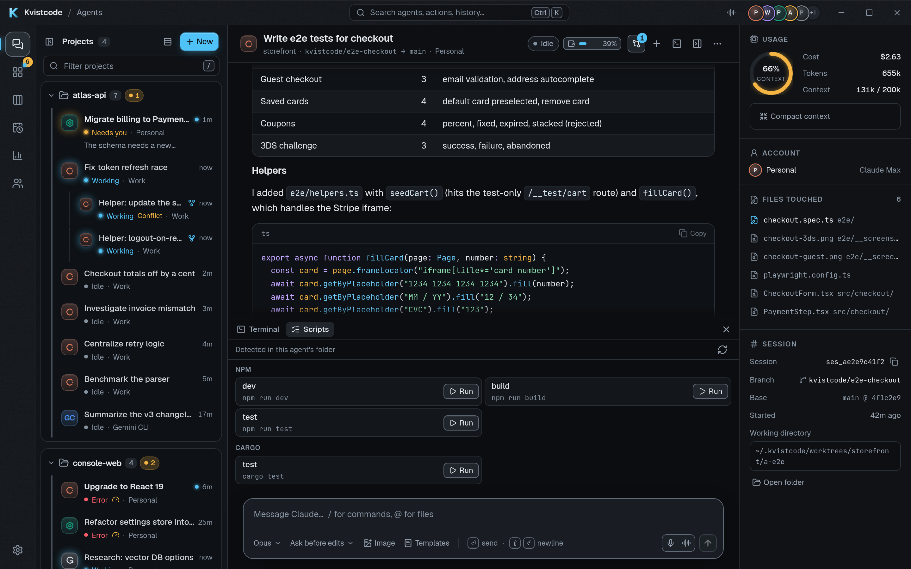

### Review and git

- **Worktree isolation.** Every agent gets its own branch and working copy.
- **Diff review.** A review sheet with syntax-highlighted diffs, per-file and per-hunk revert, a "Viewed" checkbox, and line comments that go back to the agent.
- **Commit, merge and PR.** Commit, Commit & merge or Open PR right from the end-of-turn summary (files changed, commands run, time, cost). Open a PR as a draft or against another base branch, with a description that already has the size of the change and "Closes #N".
- **PR and CI status.** Each agent shows its pull request, check results and review state. "Fix CI" sends the failing logs to the agent and "Address comments" sends reviewers' feedback; you see and can edit the message first.
- **Merge from the PR panel.** Squash, merge or rebase, with a heads-up if checks are failing or review comments are still open. The panel shows the base branch and whether GitHub considers the PR ready, and can take a draft out of draft.
- **Work from GitHub issues.** Browse a project's open issues and start an agent on one, in its own worktree with a branch named after the issue.
- **Checkpoints.** Every message you send snapshots the agent's files first. "Restore to here" puts them back (with a preview, and restores can be undone) and "Restore and edit prompt" lets you try again. Your branch, commits and staged changes are never touched.

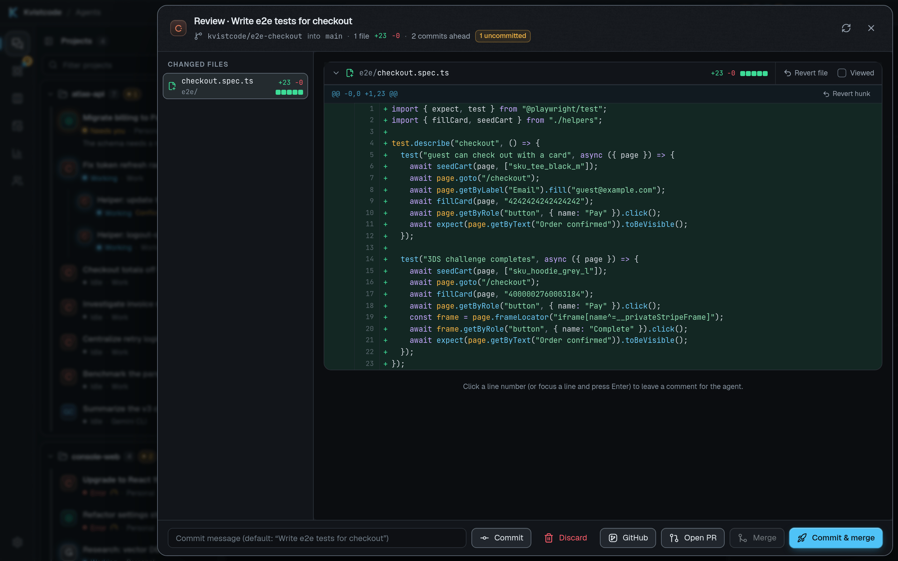

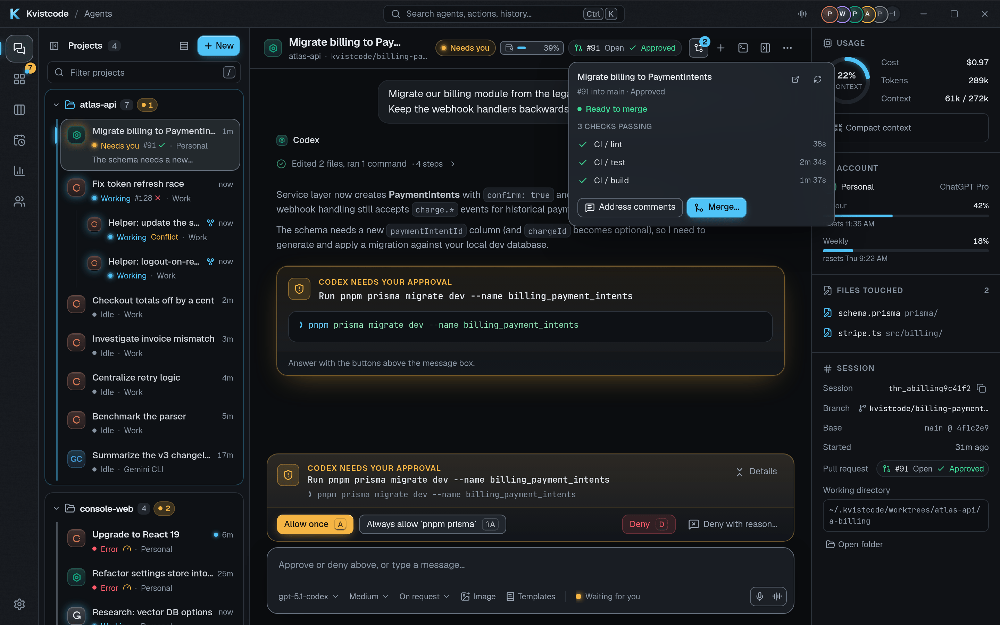

### Visibility: know what every agent is doing

- **One Mission Control**, with two tabs. **Needs you** is the queue of every pending approval, question, error, spending hold and finished task, with keyboard triage (J / K / E). **All agents** shows the whole fleet live, with a grid or list view and filters. The rail badge, tab count, window title and tray all show the same number.
- **What needs you stays pinned** above the message box wherever you have scrolled: approvals, questions with one-tap answers, blockers (usage limit, error, spending limit, merge conflict), live plan progress, and sub-agents with a timer.
- **Sub-agents you can see.** When Claude or Codex hands work to a sub-agent it appears as its own card with its tool calls nested inside, and the title bar counts running sub-agents across the fleet.
- **Usage.** The agent header shows your plan and your 5-hour and weekly usage (where the provider reports them), with per-account meters and a Usage page.
- **Notifications** the moment an agent needs you: sounds and custom sound packs, Approve / Deny in the notification on Linux (plain notifications on macOS and Windows), a phone push via ntfy, and re-pings when an approval goes stale. Alerts can also go to Slack, Discord or any webhook (see below).

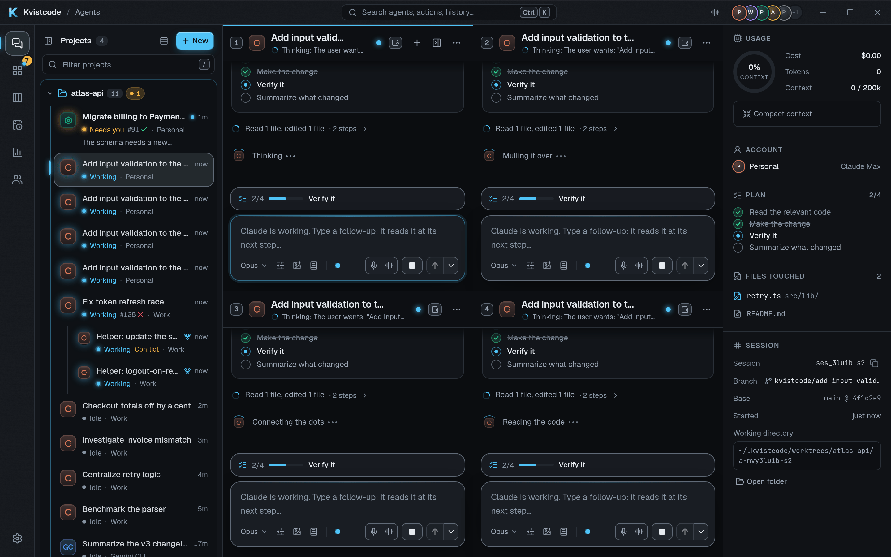

### Search and spending limits

- **Search every conversation.** Press `Ctrl/Cmd+Shift+F`, or type `?` in the command palette. It finds messages, commands, file paths and summaries, including archived agents, and jumps to the exact spot. Search runs on your computer only.
- **Spending limits.** Set a limit per agent, per project or per day, in dollars or tokens. When one is reached the agent finishes its turn (nothing is cut off), then waits in Needs you: raise the limit, continue once, or stop. A meter in the agent header shows whenever a limit applies.
- **Alerts to Slack, Discord or any webhook**, next to ntfy, with a switch for each kind of event and a Send test button. The addresses are kept in your OS keychain.

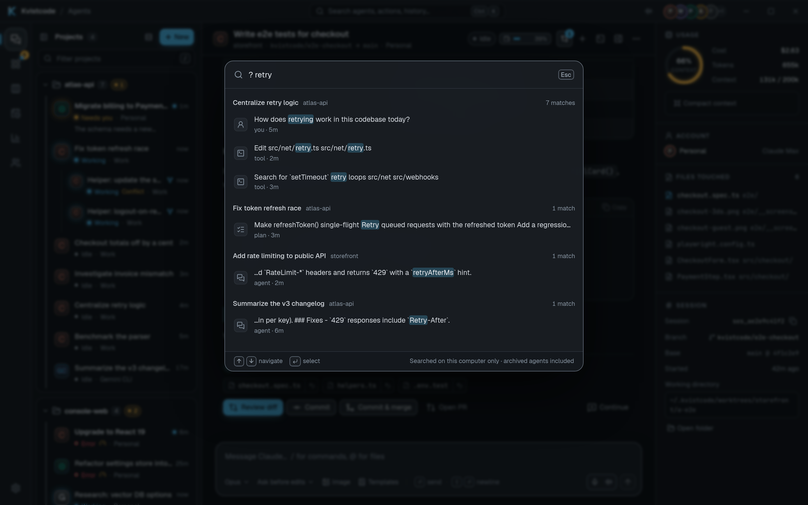

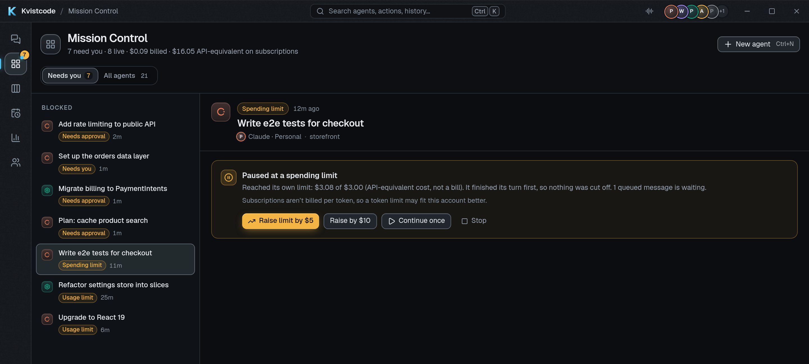

### Voice dictation

Press the mic in the message box (Ctrl/Cmd+Shift+D) and speak. Speech is transcribed on your computer with Whisper; audio never leaves it. The speech model is downloaded once, when you choose to (about 148 MB by default).

### Voice assistant

Optional and off by default. Press Ctrl/Cmd+Shift+A and just talk: ask what your agents are doing, start one, message or stop one, or open a view. It uses OpenAI's Realtime API (`gpt-realtime`), so it needs an OpenAI API key account, **sends your voice and the agent information it reads to OpenAI**, and is billed per minute to that account. It can never approve permissions, delete agents, commit or push.

Say "mute", "pause listening", "stop listening" or "go to sleep" (or press the Mute button) and Kvistcode hangs up and releases the microphone: nothing is sent or billed while it is paused. Press Unmute or Ctrl/Cmd+Shift+A to carry on; that starts a fresh conversation, so the earlier context is not kept. Waking by voice is not possible yet, because nothing is listening while paused; that needs an on-device wake-word engine, which Kvistcode does not have.

### Phone companion

Pair your phone with a QR code and run the fleet from it, from anywhere over Tailscale or on the same Wi-Fi as your computer: start agents in any project, send prompts with photos, approve or deny requests, switch mode, model and account, stop, resume or remove agents, manage queued messages, review diffs and Commit & merge, and follow sub-agents and turn summaries live. The pinned dock is there too, so what needs you stays in reach. **Read-only share links** let a teammate follow one agent live.

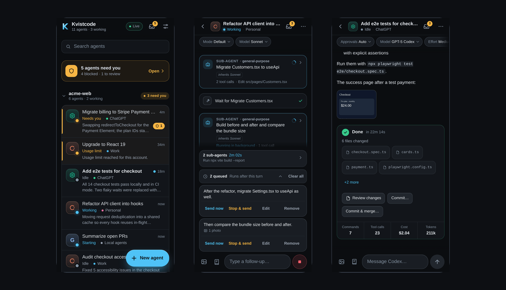

> **Remote-control safety.** Choose **Tailscale** in Settings → Phone & remote: Kvistcode stays on this computer only and Tailscale Serve shares it with your own devices over HTTPS, with nothing opened on your network. Local network access is plain HTTP, for networks you trust. Don't expose the port to the internet.

### Automation

- **Schedules.** "Every weekday at 9:00, check for dependency updates."
- **Prompt templates** with fill-in placeholders.
- **Tools & instructions.** One Settings page to edit `CLAUDE.md` and `AGENTS.md` (with a warning if the file changed on disk), configure **MCP servers** once for every agent on every provider (or per project) with a connection test, and browse your skills and plugins.
- **Rate-limit failover.** When an account hits its usage limit, continue on another signed-in account (ask first, or switch automatically; off by default).
- **Auto mode by default** for agents that offer one (Claude, Codex and any ACP agent with an "auto" mode); pick Ask per agent. New agents start without a prompt and wait for you.
- **Export** any conversation as Markdown or JSON.

### Accounts

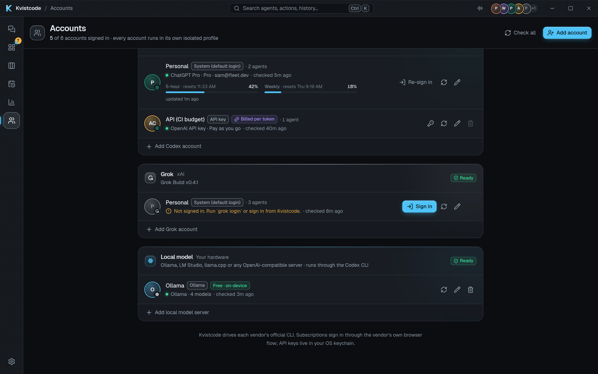

### Privacy and security

- Kvistcode doesn't reimplement agents or scrape logins. Each account runs in its own config directory (`CLAUDE_CONFIG_DIR`, `CODEX_HOME`, `GROK_HOME`), and API keys live in your OS keychain.
- Local-model agents talk only to the server you configure, and voice dictation runs on-device.
- The phone companion is served by the desktop app on your network. Keep it on a trusted or private network; never expose it to the internet.
- Updates are signed and verified before installing.
- Checkpoints are kept as local git refs under `refs/kvistcode/*`. They are never pushed on their own, but `git push --mirror` would send them, so don't mirror a working copy. Untracked credential files (`.env`, `*.pem`, `*.key`, `id_rsa*`, `.npmrc`, ...) are left out of checkpoints.
- Phone pushes (ntfy) say only which agent needs you by default; full message text is opt-in, with secrets scrubbed. Keep the topic name private.

## Install

Download the installer for your OS from the [latest release](https://github.com/pl0xuee/kvistcode/releases/latest):

| OS | Download |
|---|---|
| Windows | `-setup.exe` |
| macOS | `.dmg` (universal: Apple Silicon and Intel) |
| Linux | `.AppImage`, `.deb` or `.rpm` |

Kvistcode checks GitHub Releases for updates (shortly after launch, then every 6 hours, and from Settings, About). Windows, macOS and AppImage installs update in place with signed updates; `.deb` and `.rpm` installs are told when a new version exists and link to the release page.

Upgrading from Armada? Kvistcode is the same app under a new name: your agents, settings and sign-ins carry over, and updates keep working. The command is now `kvistcode` (on Linux, `kvistcode --new-agent` opens the New agent dialog, handy for a window-manager keybinding), and new agent branches start with `kvistcode/`.

On first run Kvistcode's setup installs the agent CLIs for you. If you have no Node.js it downloads a private, checksum-verified copy; no admin rights needed. Then sign in to each account from the Accounts page.

### Run models locally

1. Install [Ollama](https://ollama.com) and start it with a larger context window than its default, so the agent has room to work:
   ```bash
   OLLAMA_CONTEXT_LENGTH=32768 ollama serve
   ```
2. In Kvistcode, open **Accounts**, then **Add local model server**. Kvistcode detects Ollama (and LM Studio) automatically and lists the models it has; with Ollama you can download a recommended coding model from inside the app ("Get a model").
3. Start a new agent, choose **Local**, and pick a model. You can switch models later.

Notes: a GPU with enough memory for the model makes a big difference, and small models can struggle with tool use and long tasks. Local agents need the Codex CLI installed and a server that supports the OpenAI Responses API.

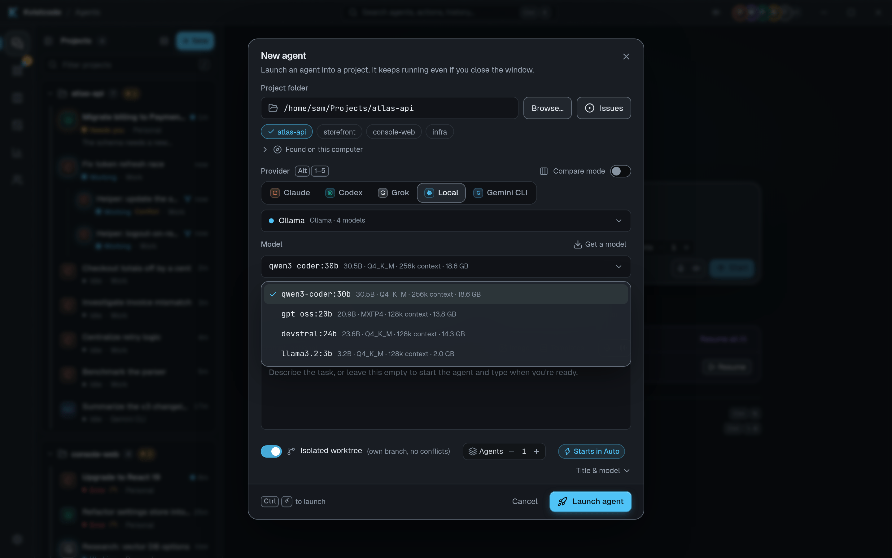

## How it works

| Provider | Runtime | Protocol |
|---|---|---|
| Claude | Claude Code + [`claude-agent-acp`](https://www.npmjs.com/package/@agentclientprotocol/claude-agent-acp) | [Agent Client Protocol](https://agentclientprotocol.com) |
| ChatGPT | Codex CLI | `codex app-server` (JSON-RPC) |
| Grok | Grok Build | ACP (`grok agent stdio`) |
| Local | Codex CLI pointed at your Ollama / LM Studio / OpenAI-compatible server | `codex app-server` |
| Anything else | Gemini CLI (`gemini --acp`), Goose (`goose acp`), OpenCode (`opencode acp`), ... | ACP |

See [`docs/PLAN.md`](docs/PLAN.md) for the architecture and roadmap.

Kvistcode also ships a light theme (Titanium):

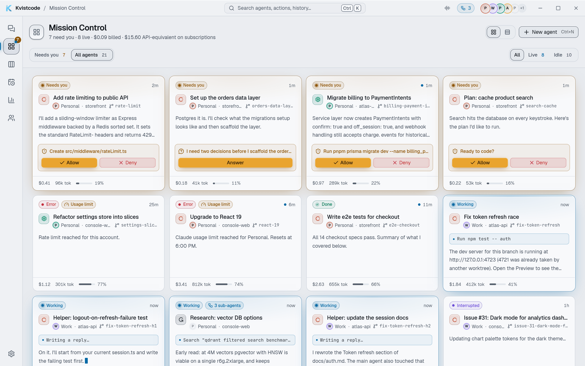

## Keyboard shortcuts

Kvistcode is fully usable from the keyboard. Press `Ctrl/Cmd+/` (or `?`) in the app for the full cheat sheet. Use `Cmd` on macOS and `Ctrl` elsewhere.

| Shortcut | Action |
|---|---|
| `Ctrl/Cmd+K` | Command palette (type `>` to start an agent) |
| `Ctrl/Cmd+N` | New agent |
| `Ctrl/Cmd+J` | Mission Control: Needs you (again for the next one) |
| `Ctrl/Cmd+I` | Mission Control: Needs you (same as J) |
| `Ctrl/Cmd+Shift+M` | Mission Control: All agents |
| `Ctrl/Cmd+Shift+A` | Voice assistant: start or end; unmute when it is paused (when turned on) |
| `Ctrl/Cmd+Shift+F` | Search every conversation (or type `?` in the palette) |
| `Ctrl/Cmd+B` | Show or hide the agent list |
| `Ctrl/Cmd+1` to `9` | Jump to an agent |
| `Ctrl/Cmd+,` | Settings |
| `Ctrl/Cmd++` / `-` / `0` | Zoom in / out / reset |
| `Ctrl/Cmd+/` | Shortcut cheat sheet (also `?`) |
| `Esc` | Close the open dialog or menu |
| `Enter` / `Shift+Enter` | Send (while the agent works: into the running turn, or queue / helper, per Settings) / new line |
| `Ctrl/Cmd+Enter` | While the agent works: start a helper agent with this message |
| `Ctrl/Cmd+Shift+D` | Dictate: start or stop |
| `/` / `@` | Slash commands / mention a file (in the message box) |
| `Esc` | Stop this turn (press twice from an empty composer) |
| `` Ctrl/Cmd+` `` | Show or hide the workspace panel |
| `Ctrl/Cmd+Shift+P` | Show or hide the web preview beside the conversation |
| `F2` | Rename the focused agent in the list |
| `A` / `Y`, `D` / `N` | Allow once / deny a pending approval (`Shift+A` always allow, press twice) |
| `J` / `K` / `Enter` / `E` / `Shift+E` | In Needs you: next / previous / open / done / archive |
| `Up` / `Down` (or `j` / `k`), `Enter`, `Ctrl/Cmd+Enter` | In a diff: move between lines, comment on the line, save the comment |

## Build from source

Prerequisites:

- Rust (stable) and Node.js 22
- `cmake`, a C++ compiler and libclang (voice dictation builds whisper.cpp and generates its bindings; preinstalled on GitHub's macOS and Windows runners)
- On Linux, the Tauri system libraries:
  ```bash
  sudo apt-get install -y \
    build-essential pkg-config cmake \
    libwebkit2gtk-4.1-dev libayatana-appindicator3-dev librsvg2-dev \
    libxdo-dev libssl-dev libasound2-dev libdbus-1-dev libclang-dev patchelf
  ```

```bash
# The phone companion is embedded into the desktop binary; build it first
# (release builds refuse to compile without apps/remote/dist).
(cd apps/remote && npm ci && npm run build)

cd apps/desktop
npm ci
npm run tauri dev      # run the app with hot reload
npm run dev            # UI only, in a browser, with a realistic mock backend
npm run tauri build -- --no-bundle   # just the binary: target/release/kvistcode
npm run tauri build -- --config '{"bundle":{"createUpdaterArtifacts":false}}'   # installers for your OS
```

Release builds use link-time optimisation, so the first one takes a while (7 to 15 minutes in our test, most of it compiling). A plain `npm run tauri build` compiles and bundles, then fails at the very end with "A public key has been found, but no private key", because the project signs its update bundles. Only the maintainer's CI has that key: use one of the two commands above (the second turns update signing off for your local build).

`npm run dev` is how the screenshots above were made: a browser build backed by an in-memory mock with fictional data. The phone companion has the same (`cd apps/remote && npm run dev`).

Releases are cut as described in [`docs/RELEASING.md`](docs/RELEASING.md); user-facing changes are listed in [`CHANGELOG.md`](CHANGELOG.md).

Handy tools for working on the core:

```bash
# One-click installer from the command line
cargo run -p kvistcode-core --example install -- /tmp/kvistcode-data all

# Drive a real agent end to end (prints every event, auto-approves)
cargo run -p kvistcode-core --example smoke -- /tmp/kvistcode-data ~/some/repo grok "Say hi"

# Point a provider at a development build of an agent
KVISTCODE_GROK_COMMAND="python3 my_agent.py" npm run tauri dev
```

## Project layout

```
crates/kvistcode-core/     agent supervisor, ACP + Codex clients, storage, accounts, installer
apps/desktop/src-tauri/    Tauri shell: commands, tray, sounds, notifications, terminals, git review
apps/desktop/src/          React UI
apps/remote/               phone companion (single-file web app served by the desktop app)
docs/                      plan, release process and screenshots
scripts/                   release notes and CI checks; gen_sounds.py synthesizes the notification sounds
```

## Contributing

Tests need no network or tokens (a mock ACP agent stands in for the real ones). CI runs all of the following, so please run them before opening a pull request:

```bash
cargo fmt --all --check
cargo clippy --workspace --all-targets -- -D warnings
cargo test --workspace
(cd apps/desktop && npx tsc --noEmit && npm test)
(cd apps/remote && npm test)
python3 scripts/check_contract.py
python3 scripts/check_unix_tests.py
```

See [`CONTRIBUTING.md`](CONTRIBUTING.md) for the details, and [`SECURITY.md`](SECURITY.md) to report a vulnerability privately.

Add a user-facing entry under `## Unreleased` in [`CHANGELOG.md`](CHANGELOG.md) for anything people using the app will notice, written for them rather than as a commit subject.

## Support

Kvistcode is free and open source. If it saves you time, you can help keep it maintained. It is entirely optional and unlocks nothing.

**By card (USD):** [GitHub Sponsors](https://github.com/sponsors/pl0xuee), one-time or monthly.

**With crypto:**

| Network | Address |
|---|---|
| Bitcoin | `bc1qytsjzn85eax5th8qdfvspluzlnfmempzcr7e8g` |
| Litecoin | `ltc1q29q307pv35z8sz8n0mtuvhz7xxeweuuf0vyfez` |
| Ethereum (ETH, and USDC on the Ethereum network) | `0x494b9d0Da5E587cF41468183Aa26a9B54432bF42` |
| Solana | `GNXW4PiETBs8tXNstYfhKsjQ2xkyfL3YosZ2Qm6a2Sts` |

The same addresses are listed, with QR codes, at [kvistcode.com/support](https://kvistcode.com/support/). If the two ever differ, don't send anything and open an issue. Crypto transfers can't be reversed, so check the network before you send.

## License

[MIT](LICENSE)
