<div align="center">

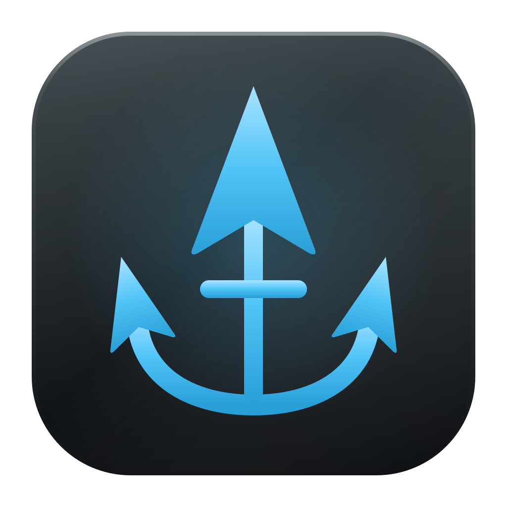

# Armada

**Command your fleet of AI coding agents.**

One desktop app to run Claude Code, OpenAI Codex, xAI Grok, local models and any ACP agent side by side,<br />
across all your accounts, with every project isolated in its own git worktree.

[](https://github.com/pl0xuee/armada/actions/workflows/ci.yml)
[](https://github.com/pl0xuee/armada/releases/latest)
[](LICENSE)


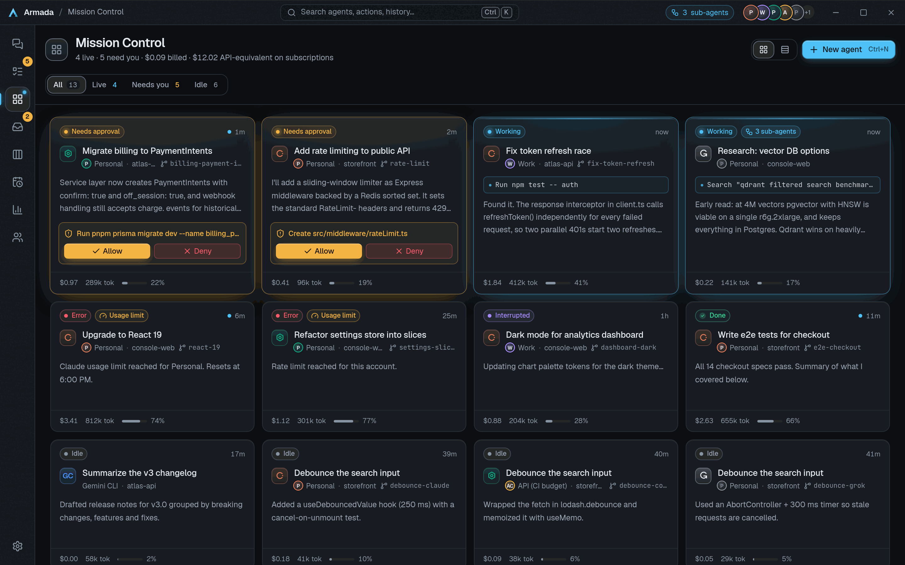

</div>

> The screenshots in this README come from Armada's built-in demo data (fictional projects and accounts), not from a real workspace.

## Why Armada

Coding agents are most useful when you can run several at once, but each vendor ships its own terminal UI, its own login and its own idea of a session. Armada puts them in one place. It drives each vendor's **official agent runtime** (it never reimplements an agent or scrapes a login), so your subscriptions are used exactly as the vendor intends. Each agent gets its own branch and working copy, so parallel work doesn't collide, and you get one live view of who is working, who is stuck and who needs you.

## Features

### Agents from every provider

- **Claude Code, OpenAI Codex, xAI Grok Build**, plus any agent that speaks the [Agent Client Protocol](https://agentclientprotocol.com) (Gemini CLI, Goose, OpenCode or your own), added as a first-class provider with a connection test.
- **Local models.** Run agents on Ollama, LM Studio or any OpenAI-compatible server (llama.cpp, vLLM, a GPU box on your network). Armada detects Ollama and LM Studio, lists their models, and lets you pick one per agent. Local agents are free and need no sign-in; nothing leaves your computer unless you point at another machine, which Armada warns about. See the [quickstart](#run-models-locally).
- **Multiple accounts per provider.** Every account has its own isolated login, so you can run two Claude Max accounts and three ChatGPT accounts at once. API keys are kept in your OS keychain.
- **Compare mode.** Send one prompt to several providers, read the answers side by side and keep the one you like. **Handoff** lets one agent review another's work ("have Codex review Claude's work").
- Agents survive closing the window (Armada lives in the tray), crashes and reboots, and can be resumed.
- Messages typed while an agent is busy queue up and run in order; edit, drop or send one right now. Paste screenshots or attach images, and `@`-mention files with fuzzy search. Slash-command autocomplete shows each agent's own commands.

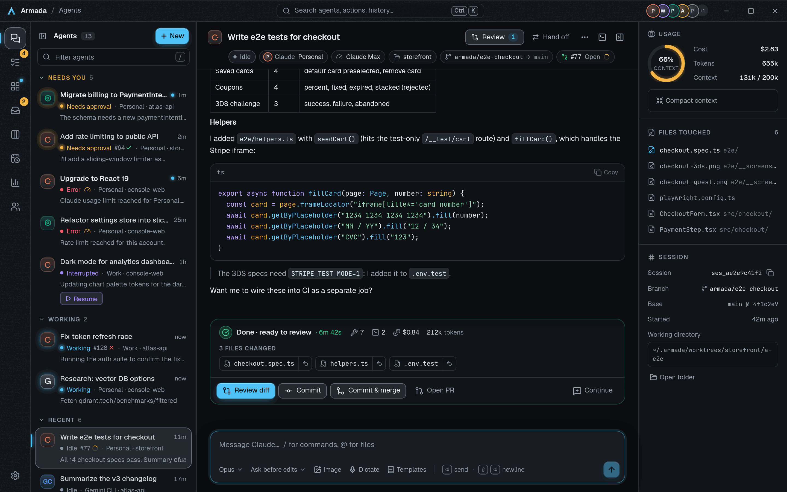

### A calmer conversation

- **Quiet timeline.** Runs of tool calls and thoughts fold into one line ("Read 4 files, edited 2 files, ran 3 commands"); answers, approvals, plans and errors stay in view.
- **Clear signals.** A thinking indicator while the agent works, then a "Done" line with the turn's time, a green status pill, a window title that shows what the selected agent is doing, and an optional chime for long tasks.
- **Syntax highlighting** in code blocks, diffs and commands, matching each theme (Gunmetal, Carbon and Titanium).
- **Images inline.** Screenshots that agents take or view appear as pictures, not file paths.

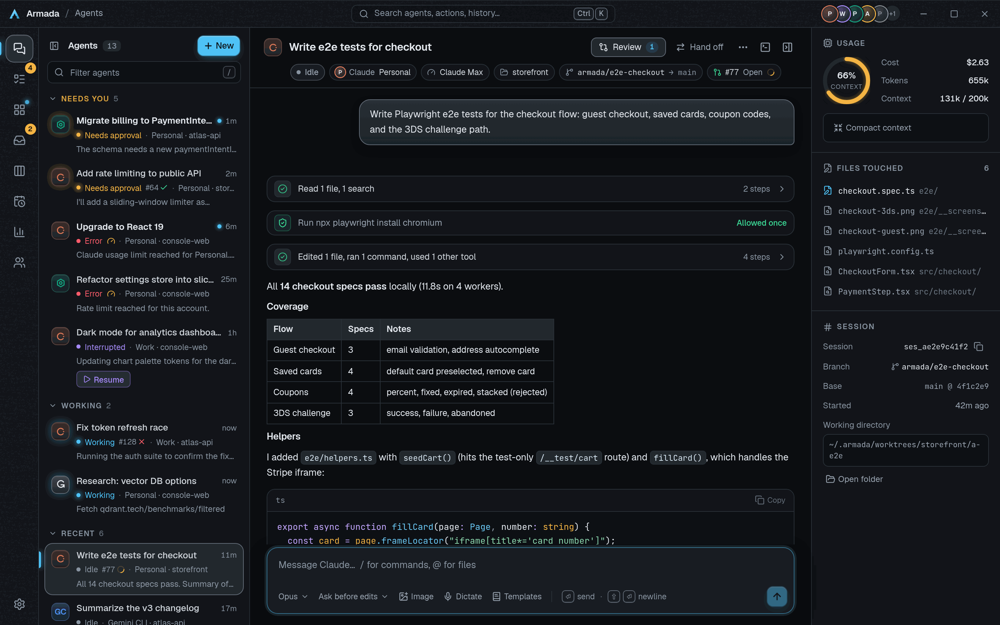

### Workspace: terminals, scripts, preview

Each agent has a workspace panel (`` Ctrl/Cmd+` ``) in its own folder:

- **Terminals** with a "Send to agent" button that pastes output into the message box.
- **Scripts** detected from your project (npm, pnpm, yarn, bun, cargo, make, just, pytest, go), one click to run.
- **Live preview.** When an agent or one of your terminals starts a dev server it appears in the Preview tab beside the conversation, with device widths and reload. Only servers on your own computer are shown.
- **Run from the chat.** Shell code blocks in replies have a Run button that opens a terminal in the workspace and runs them. Risky commands (such as `rm -rf` or `sudo`) ask first, and "Paste without running" puts the commands in the terminal and leaves pressing Enter to you.

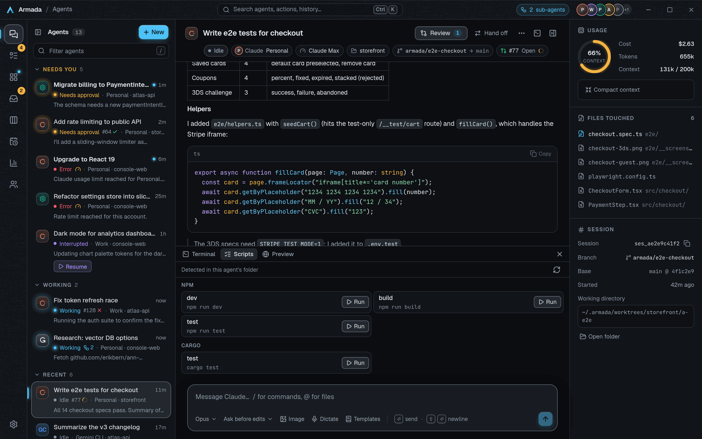

### Review and git

- **Worktree isolation.** Every agent gets its own branch and working copy.
- **Diff review.** A review sheet with syntax-highlighted diffs, per-file and per-hunk revert, a "Viewed" checkbox, and line comments that go back to the agent.
- **Commit, merge and PR.** Commit, Commit & merge or Open PR right from the end-of-turn summary (files changed, commands run, time, cost).
- **PR and CI status.** Each agent shows its pull request, check results and review state. "Fix CI" sends the failing logs to the agent and "Address comments" sends reviewers' feedback; you see and can edit the message first.
- **Checkpoints.** Every message you send snapshots the agent's files first. "Restore to here" puts them back (with a preview, and restores can be undone) and "Restore and edit prompt" lets you try again. Your branch, commits and staged changes are never touched.

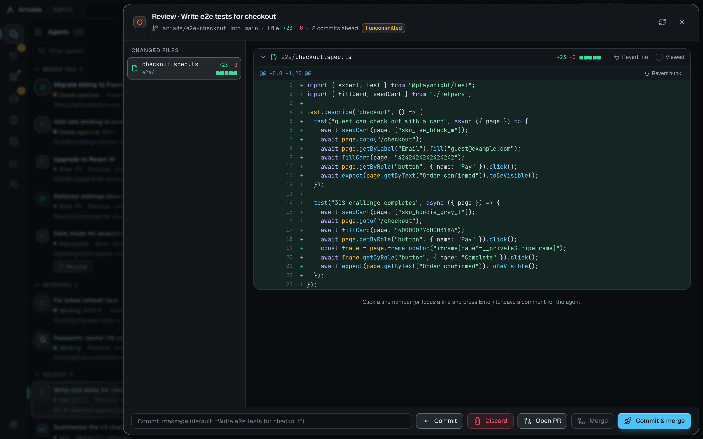

### Visibility: know what every agent is doing

- **Mission Control** shows the whole fleet live, with a grid or list view, filters and Allow / Deny right on the cards.
- **Inbox and "Needs you"** collect every pending approval and finished task, with keyboard triage (J / K / E).
- **Sub-agents you can see.** When Claude or Codex hands work to a sub-agent it appears as its own card with its tool calls nested inside, and the title bar counts running sub-agents across the fleet.
- **Usage and limits.** The agent header shows your plan and your 5-hour and weekly usage (where the provider reports them), with per-account meters and a Usage page.
- **Notifications** the moment an agent needs you: sounds and custom sound packs, Approve / Deny in the notification on Linux (plain notifications on macOS and Windows), a phone push via ntfy, and re-pings when an approval goes stale.

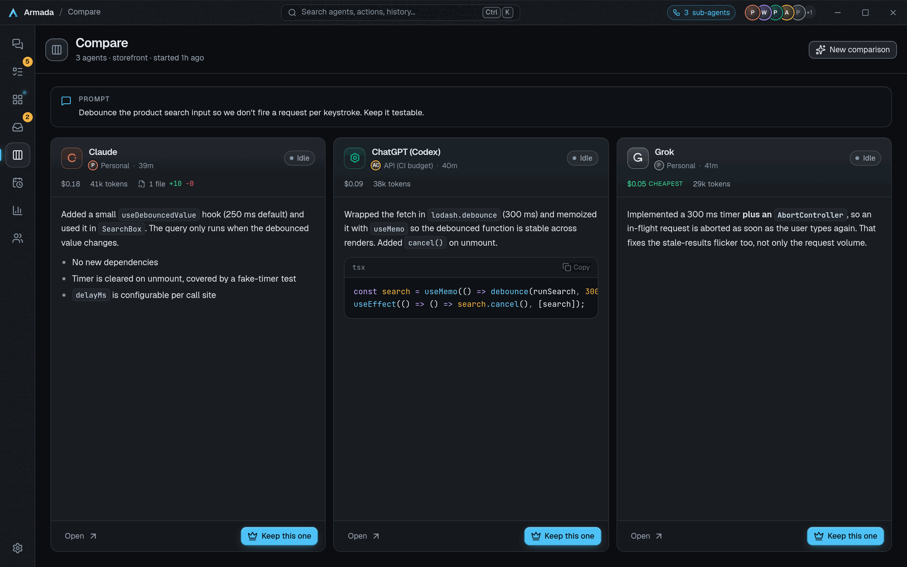

### Voice dictation

Press the mic in the message box (Ctrl/Cmd+Shift+D) and speak. Speech is transcribed on your computer with Whisper; audio never leaves it. The speech model is downloaded once, when you choose to (about 142 MB by default).

### Voice assistant

Optional and off by default. Press Ctrl/Cmd+Shift+A and just talk: ask what your agents are doing, start one, message or stop one, or open a view. It uses OpenAI's Realtime API (`gpt-realtime`), so it needs an OpenAI API key account, **sends your voice and the agent information it reads to OpenAI**, and is billed per minute to that account. It can never approve permissions, delete agents, commit or push.

### Phone companion

Pair your phone with a QR code and run the fleet from it while it is on the same network as your computer: start agents in any project, send prompts with photos, approve or deny requests, switch mode, model and account, stop, resume or remove agents, manage queued messages, review diffs and Commit & merge, and follow sub-agents and turn summaries live. **Read-only share links** let a teammate follow one agent live.

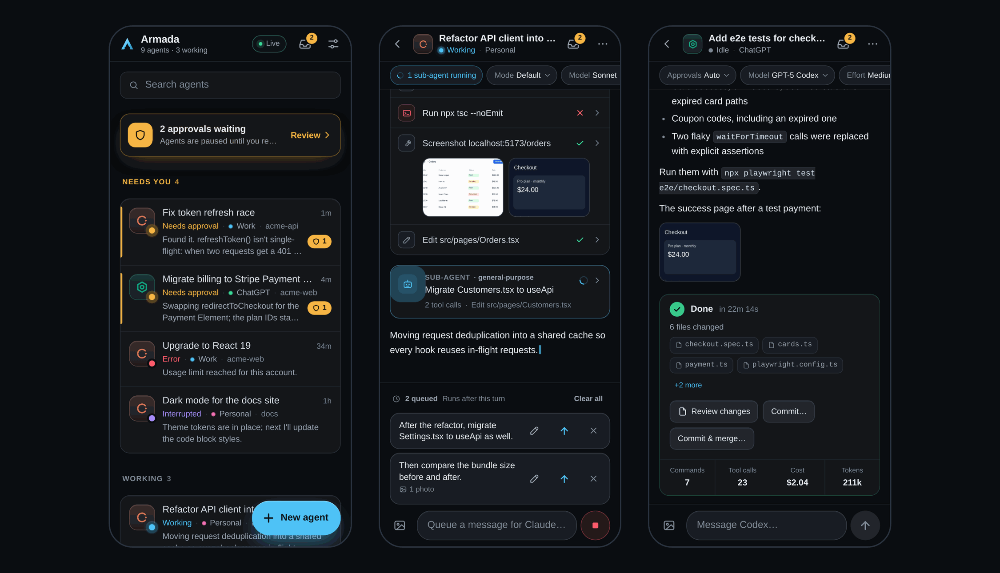

> **Remote-control safety.** For access from anywhere, use a private network such as Tailscale. Don't expose the port to the internet.

### Automation

- **Schedules.** "Every weekday at 9:00, check for dependency updates."
- **Prompt templates** with fill-in placeholders.
- **MCP servers, configured once** and given to every agent on every provider. Paste a config snippet and test the connection in Settings.
- **Rate-limit failover.** When an account hits its usage limit, continue on another signed-in account (ask first, or switch automatically; off by default).
- **Auto mode by default** for agents that offer one (Claude, Codex and any ACP agent with an "auto" mode); pick Ask per agent. New agents start without a prompt and wait for you.
- **Export** any conversation as Markdown or JSON, and search across your whole history.

### Accounts

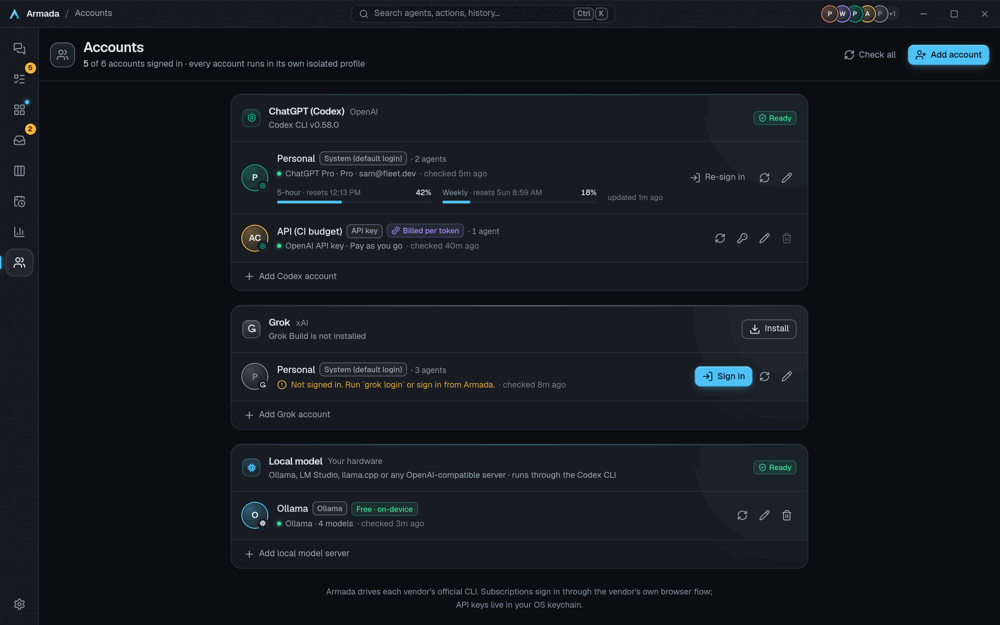

### Privacy and security

- Armada doesn't reimplement agents or scrape logins. Each account runs in its own config directory (`CLAUDE_CONFIG_DIR`, `CODEX_HOME`, `GROK_HOME`), and API keys live in your OS keychain.
- Local-model agents talk only to the server you configure, and voice dictation runs on-device.
- The phone companion is served by the desktop app on your network. Keep it on a trusted or private network; never expose it to the internet.
- Updates are signed and verified before installing.
- Checkpoints are kept as local git refs under `refs/armada/*`. They are never pushed on their own, but `git push --mirror` would send them, so don't mirror a working copy. Untracked credential files (`.env`, `*.pem`, `*.key`, `id_rsa*`, `.npmrc`, ...) are left out of checkpoints.
- Phone pushes (ntfy) say only which agent needs you by default; full message text is opt-in, with secrets scrubbed. Keep the topic name private.

## Install

Download the installer for your OS from the [latest release](https://github.com/pl0xuee/armada/releases/latest):

| OS | Download |
|---|---|
| Windows | `-setup.exe` |
| macOS | `.dmg` (universal: Apple Silicon and Intel) |
| Linux | `.AppImage`, `.deb` or `.rpm` |

Armada checks GitHub Releases for updates (shortly after launch, then every 6 hours, and from Settings, About). Windows, macOS and AppImage installs update in place with signed updates; `.deb` and `.rpm` installs are told when a new version exists and link to the release page.

On first run Armada's setup installs the agent CLIs for you. If you have no Node.js it downloads a private, checksum-verified copy; no admin rights needed. Then sign in to each account from the Accounts page.

### Run models locally

1. Install [Ollama](https://ollama.com) and start it with a larger context window than its default, so the agent has room to work:
   ```bash
   OLLAMA_CONTEXT_LENGTH=32768 ollama serve
   ```
2. In Armada, open **Accounts**, then **Add local model server**. Armada detects Ollama (and LM Studio) automatically and lists the models it has; with Ollama you can download a recommended coding model from inside the app ("Get a model").
3. Start a new agent, choose **Local**, and pick a model. You can switch models later.

Notes: a GPU with enough memory for the model makes a big difference, and small models can struggle with tool use and long tasks. Local agents need the Codex CLI installed and a server that supports the OpenAI Responses API.

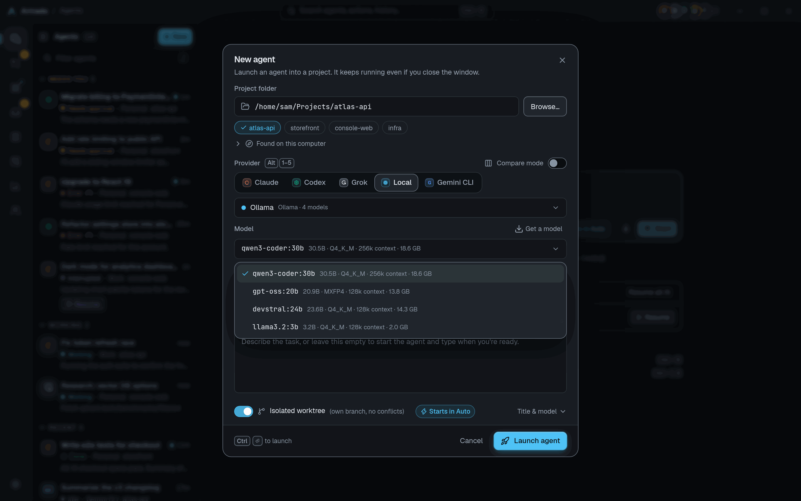

## How it works

| Provider | Runtime | Protocol |
|---|---|---|
| Claude | Claude Code + [`claude-agent-acp`](https://www.npmjs.com/package/@agentclientprotocol/claude-agent-acp) | [Agent Client Protocol](https://agentclientprotocol.com) |
| ChatGPT | Codex CLI | `codex app-server` (JSON-RPC) |
| Grok | Grok Build | ACP (`grok agent stdio`) |
| Local | Codex CLI pointed at your Ollama / LM Studio / OpenAI-compatible server | `codex app-server` |
| Anything else | Gemini CLI (`gemini --acp`), Goose (`goose acp`), OpenCode (`opencode acp`), ... | ACP |

See [`docs/PLAN.md`](docs/PLAN.md) for the architecture and roadmap.

Armada also ships a light theme (Titanium):

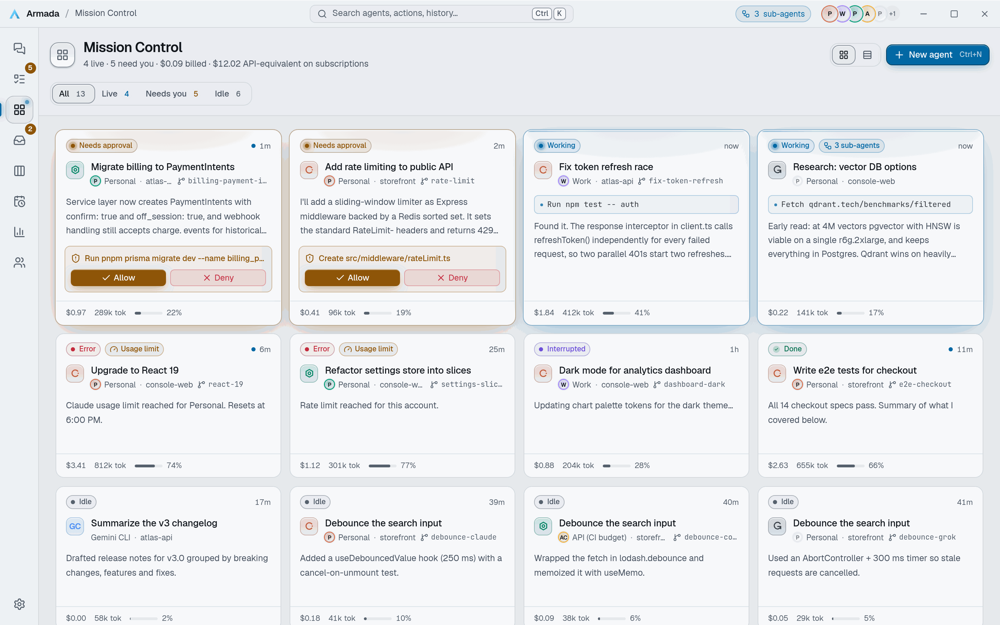

## Keyboard shortcuts

Armada is fully usable from the keyboard. Press `Ctrl/Cmd+/` (or `?`) in the app for the full cheat sheet. Use `Cmd` on macOS and `Ctrl` elsewhere.

| Shortcut | Action |
|---|---|
| `Ctrl/Cmd+K` | Command palette (type `>` to start an agent) |
| `Ctrl/Cmd+N` | New agent |
| `Ctrl/Cmd+J` | Needs you (again for the next one) |
| `Ctrl/Cmd+I` | Inbox |
| `Ctrl/Cmd+Shift+M` | Mission Control |
| `Ctrl/Cmd+B` | Show or hide the agent list |
| `Ctrl/Cmd+1` to `9` | Jump to an agent |
| `Ctrl/Cmd+,` | Settings |
| `Ctrl/Cmd++` / `-` / `0` | Zoom in / out / reset |
| `Ctrl/Cmd+/` | Shortcut cheat sheet (also `?`) |
| `Esc` | Close the open dialog or menu |
| `Enter` / `Shift+Enter` | Send (queues if busy) / new line |
| `Ctrl/Cmd+Shift+D` | Dictate: start or stop |
| `/` / `@` | Slash commands / mention a file (in the message box) |
| `Esc` | Stop this turn (press twice from an empty composer) |
| `` Ctrl/Cmd+` `` | Show or hide the workspace panel |
| `F2` | Rename the focused agent in the list |
| `J` / `K` / `Enter` / `E` / `Shift+E` | In Needs you: next / previous / open / done / archive |
| `Up` / `Down` (or `j` / `k`), `Enter`, `Ctrl/Cmd+Enter` | In a diff: move between lines, comment on the line, save the comment |

## Build from source

Prerequisites:

- Rust (stable) and Node.js 22
- `cmake` and a C++ compiler (voice dictation builds whisper.cpp; preinstalled on GitHub runners)
- On Linux, the Tauri system libraries:
  ```bash
  sudo apt-get install -y \
    build-essential pkg-config cmake \
    libwebkit2gtk-4.1-dev libayatana-appindicator3-dev librsvg2-dev \
    libxdo-dev libssl-dev libasound2-dev libdbus-1-dev patchelf
  ```

```bash
# The phone companion is embedded into the desktop binary; build it first
# (release builds refuse to compile without apps/remote/dist).
(cd apps/remote && npm ci && npm run build)

cd apps/desktop
npm ci
npm run tauri dev      # run the app with hot reload
npm run dev            # UI only, in a browser, with a realistic mock backend
npm run tauri build    # produce installers for your OS
```

`npm run dev` is how the screenshots above were made: a browser build backed by an in-memory mock with fictional data. The phone companion has the same (`cd apps/remote && npm run dev`).

Releases are cut as described in [`docs/RELEASING.md`](docs/RELEASING.md); user-facing changes are listed in [`CHANGELOG.md`](CHANGELOG.md).

Handy tools for working on the core:

```bash
# One-click installer from the command line
cargo run -p armada-core --example install -- /tmp/armada-data all

# Drive a real agent end to end (prints every event, auto-approves)
cargo run -p armada-core --example smoke -- /tmp/armada-data ~/some/repo grok "Say hi"

# Point a provider at a development build of an agent
ARMADA_GROK_COMMAND="python3 my_agent.py" npm run tauri dev
```

## Project layout

```
crates/armada-core/        agent supervisor, ACP + Codex clients, storage, accounts, installer
apps/desktop/src-tauri/    Tauri shell: commands, tray, sounds, notifications, terminals, git review
apps/desktop/src/          React UI
apps/remote/               phone companion (single-file web app served by the desktop app)
docs/                      plan, release process and screenshots
scripts/                   release notes tooling; gen_sounds.py synthesizes the notification sounds
```

## Contributing

Tests need no network or tokens (a mock ACP agent stands in for the real ones). CI runs all of the following, so please run them before opening a pull request:

```bash
cargo fmt --all --check
cargo clippy --workspace --all-targets -- -D warnings
cargo test --workspace
(cd apps/desktop && npx tsc --noEmit && npm test)
(cd apps/remote && npm test)
```

Add a user-facing entry under `## Unreleased` in [`CHANGELOG.md`](CHANGELOG.md) for anything people using the app will notice, written for them rather than as a commit subject.

## License

[MIT](LICENSE)
